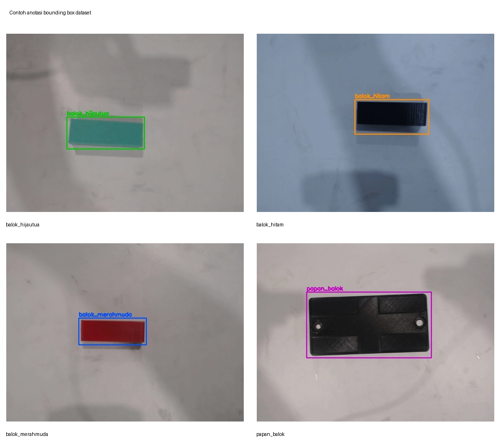
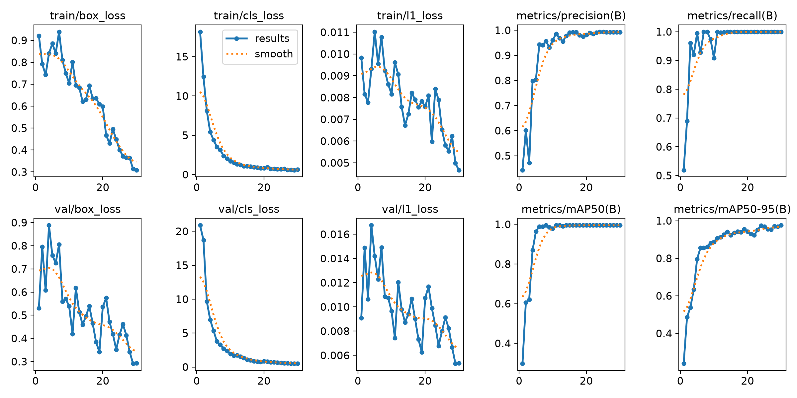
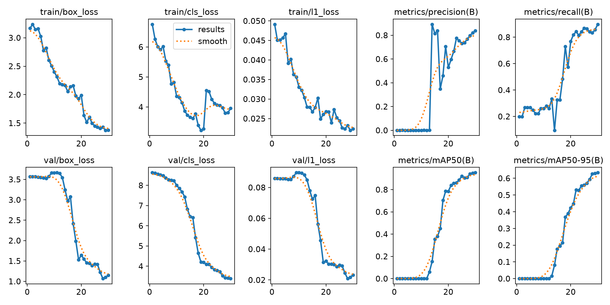
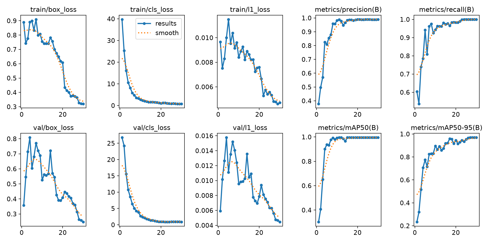
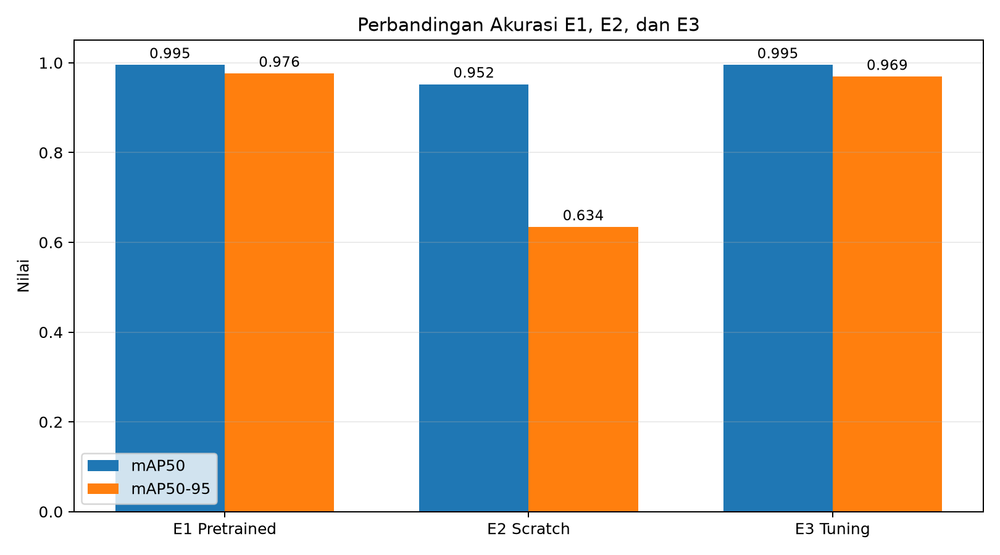
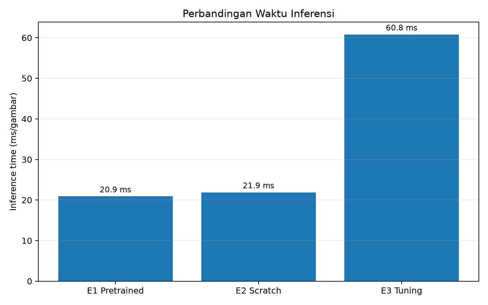
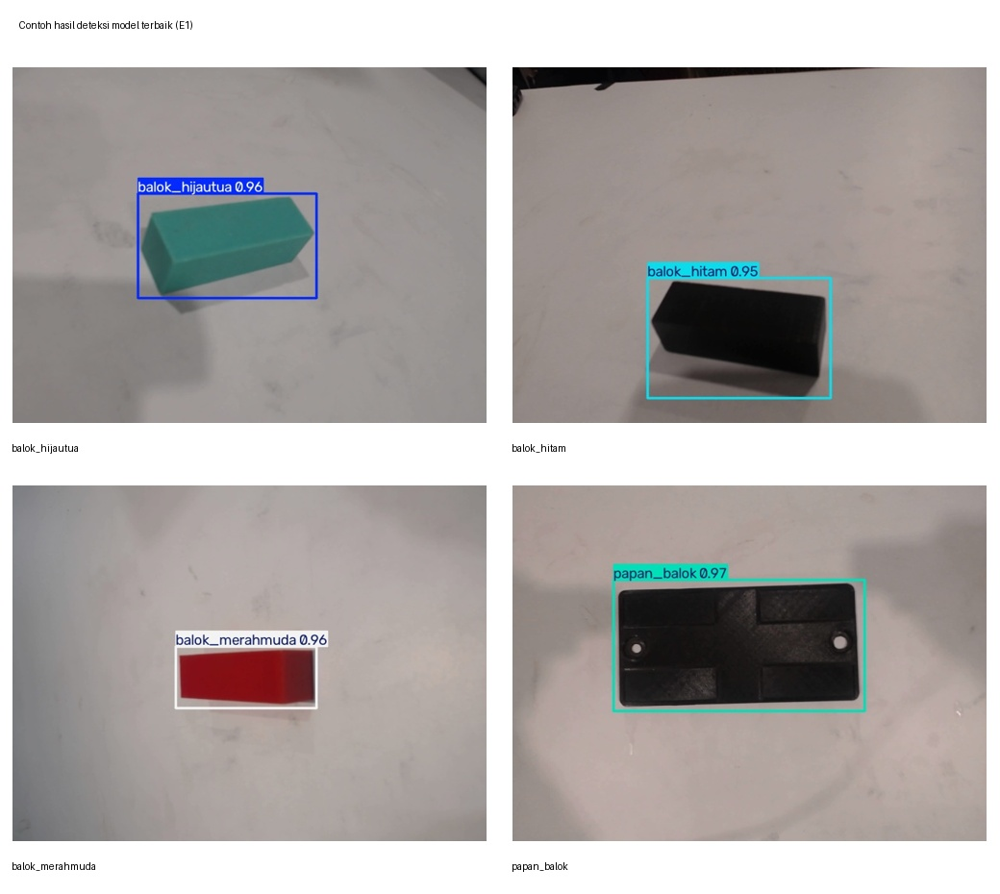

# Deteksi Objek Balok Menggunakan YOLO26n

<p align="center">
  <b>Perbandingan Pretrained, Scratch, dan Hyperparameter Tuning pada YOLO26n</b>
</p>

<p align="center">
  <b>Mikha Shintia Sitorus</b><br>
  NIM 4222401060
</p>

---

## Ringkasan Proyek

Proyek ini mengimplementasikan **object detection menggunakan YOLO26n** untuk mendeteksi empat kelas objek balok. Tahapan yang dilakukan meliputi seleksi dan anotasi dataset, pemeriksaan label, konversi format YOLO ↔ COCO, pembagian dataset, training tiga eksperimen, perbandingan performa, pemilihan model terbaik, serta pengujian pada test set.

Empat kelas yang digunakan:

| ID | Kelas | Jumlah Gambar |
|---:|---|---:|
| 0 | `balok_hijautua` | 50 |
| 1 | `balok_hitam` | 50 |
| 2 | `balok_merahmuda` | 50 |
| 3 | `papan_balok` | 50 |
|  | **Total** | **200** |

---

## 1. Dataset dan Anotasi

Dataset final terdiri dari **200 gambar** yang telah diseleksi untuk mengurangi gambar blur, kurang jelas, atau kurang representatif. Setiap kelas memiliki **50 gambar**, sehingga dataset tetap seimbang.

Anotasi menggunakan format YOLO:

```text
class_id x_center y_center width height
```

### Contoh Anotasi Empat Kelas

<p align="center">
  
</p>

---

## 2. Pemeriksaan Anotasi

Pemeriksaan anotasi dilakukan menggunakan:

```bash
python3 01_cek_anotasi.py dataset_yolo
```

Hasil:

```text
Gambar          : 200
Tanpa file label: 0
Label kosong    : 0

Jumlah kotak per kelas:
  balok_hijautua : 50
  balok_hitam    : 50
  balok_merahmuda: 50
  papan_balok    : 50

0 masalah ditemukan.
```

Hasil tersebut menunjukkan seluruh gambar memiliki anotasi yang valid dan tidak ditemukan label yang hilang atau kosong.

---

## 3. Konversi YOLO ke COCO

Dataset YOLO dikonversi ke format COCO menggunakan:

```bash
python3 02_yolo_ke_coco.py dataset_yolo
```

Hasil:

```text
200 gambar, 200 kotak, 4 kategori
```

File COCO tersimpan pada:

```text
dataset_yolo/annotations_coco.json
```

---

## 4. Konversi COCO ke YOLO

Dataset COCO kemudian dikonversi kembali ke YOLO menggunakan:

```bash
python3 03_coco_ke_yolo.py \
dataset_yolo/annotations_coco.json \
hasil_yolo
```

Hasil:

```text
200 file label dibuat di hasil_yolo/labels
```

Jumlah label diperiksa dengan:

```bash
find hasil_yolo/labels -type f -name "*.txt" | wc -l
```

Hasil:

```text
200
```

---

## 5. Pembagian Dataset

Dataset dibagi menjadi:

| Dataset | Persentase | Jumlah |
|---|---:|---:|
| Train | 70% | 140 |
| Validation | 20% | 40 |
| Test | 10% | 20 |
| **Total** | **100%** | **200** |

Struktur dataset:

```text
dataset_v1/
├── data.yaml
├── images/
│   ├── train/
│   ├── val/
│   └── test/
└── labels/
    ├── train/
    ├── val/
    └── test/
```

Isi `data.yaml`:

```yaml
path: dataset_v1
train: images/train
val: images/val
test: images/test

names:
  0: balok_hijautua
  1: balok_hitam
  2: balok_merahmuda
  3: papan_balok
```

---

## 6. Konfigurasi Training

Training menggunakan **Ultralytics YOLO26n** dengan konfigurasi dasar:

| Parameter | Nilai |
|---|---|
| Model | YOLO26n |
| Epoch | 30 |
| Batch Size | 16 |
| Image Size | 416 |
| Train | 140 gambar |
| Validation | 40 gambar |
| Test | 20 gambar |
| Device | CPU |
| Processor | AMD Ryzen 5 7520U with Radeon Graphics |

Perintah training:

```bash
python 06_latih_bandingkan.py \
--nim 4222401060 \
--nama "Mikha Shintia Sitorus" \
--data dataset_v1/data.yaml \
--model yolo26n \
--epochs 30 \
--imgsz 416 \
--batch 16 \
--device cpu
```

---

# 7. Eksperimen

## E1 — Pretrained

E1 menggunakan **YOLO26n pretrained** dengan:

```text
Model      : yolo26n.pt
Pretrained : True
Epoch      : 30
Image Size : 416
Batch Size : 16
```

### Grafik Training E1

<p align="center">
  
</p>

### Hasil E1

| Metric | Nilai |
|---|---:|
| Precision | 0.992 |
| Recall | 1.000 |
| mAP50 | 0.995 |
| mAP50-95 | **0.976** |
| Inference Time | **20.9 ms** |
| Training Time | 10.8 menit |

---

## E2 — Scratch

E2 menggunakan arsitektur YOLO26n tanpa pretrained weight:

```text
Model      : yolo26n.yaml
Pretrained : False
Epoch      : 30
Image Size : 416
Batch Size : 16
```

### Grafik Training E2

<p align="center">
  
</p>

### Hasil E2

| Metric | Nilai |
|---|---:|
| Precision | 0.839 |
| Recall | 0.898 |
| mAP50 | 0.952 |
| mAP50-95 | 0.634 |
| Inference Time | 21.9 ms |
| Training Time | 10.7 menit |

---

## E3 — Hyperparameter Tuning

E3 menggunakan pretrained model yang sama dengan E1, tetapi **image size dinaikkan dari 416 menjadi 640**.

```text
Model      : yolo26n.pt
Pretrained : True
Epoch      : 30
Image Size : 640
Batch Size : 16
```

### Grafik Training E3

<p align="center">
  
</p>

### Hasil E3

| Metric | Nilai |
|---|---:|
| Precision | 0.989 |
| Recall | 1.000 |
| mAP50 | 0.995 |
| mAP50-95 | 0.969 |
| Inference Time | 60.8 ms |
| Training Time | 26.1 menit |

---

# 8. Perbandingan E1, E2, dan E3

| Eksperimen | Pretrained | Image Size | mAP50 | mAP50-95 | Precision | Recall | Inference |
|---|---|---:|---:|---:|---:|---:|---:|
| **E1 Pretrained** | Ya | 416 | **0.995** | **0.976** | **0.992** | **1.000** | **20.9 ms** |
| E2 Scratch | Tidak | 416 | 0.952 | 0.634 | 0.839 | 0.898 | 21.9 ms |
| E3 Tuning | Ya | 640 | **0.995** | 0.969 | 0.989 | **1.000** | 60.8 ms |

### Perbandingan Akurasi

<p align="center">
  
</p>

### Perbandingan Waktu Inferensi

<p align="center">
  
</p>

---

## 9. Analisis Eksperimen

### E1 vs E2 — Pengaruh Pretrained Weight

E1 menghasilkan **mAP50-95 = 0.976**, sedangkan E2 hanya mencapai **0.634**. Perbedaan utama kedua eksperimen adalah penggunaan pretrained weight.

Pada E1, model telah memiliki representasi awal dari proses training sebelumnya sehingga proses adaptasi terhadap dataset baru menjadi lebih cepat dan efektif. Sebaliknya, E2 memulai proses pembelajaran dari bobot acak dan harus mempelajari feature extraction serta object detection dari awal.

Dengan dataset yang hanya berjumlah 200 gambar, pretrained model memberikan keuntungan yang sangat besar. Hasil ini menunjukkan bahwa **transfer learning lebih efektif dibandingkan training from scratch untuk dataset berukuran relatif kecil**.

### E1 vs E3 — Pengaruh Image Size

E3 meningkatkan `imgsz` dari **416 menjadi 640**.

Hasilnya:

```text
E1 mAP50-95 = 0.976
E3 mAP50-95 = 0.969
```

Peningkatan resolusi tidak meningkatkan akurasi. Sebaliknya, inference time meningkat dari:

```text
20.9 ms → 60.8 ms
```

dan training time meningkat dari:

```text
10.8 menit → 26.1 menit
```

Dengan demikian, `imgsz=416` memberikan kombinasi performa dan efisiensi yang lebih baik untuk dataset ini.

---

# 10. Model Terbaik

Pemilihan model dilakukan berdasarkan **mAP50-95 pada validation set**.

```text
E1 Pretrained : 0.976
E2 Scratch    : 0.634
E3 Tuning     : 0.969
```

Model terbaik adalah:

```text
E1_pretrained
```

Weight terbaik:

```text
hasil_praktik/E1_pretrained/weights/best.pt
```

---

# 11. Pengujian Model Terbaik

Model E1 kemudian diuji **satu kali pada test set** yang terdiri dari 20 gambar.

Hasil:

| Metric | Test Set |
|---|---:|
| mAP50 | **0.995** |
| mAP50-95 | **0.991** |

Prediksi visual dijalankan menggunakan:

```bash
yolo detect predict \
model=hasil_praktik/E1_pretrained/weights/best.pt \
source=dataset_v1/images/test \
imgsz=416 \
conf=0.25 \
device=cpu \
save=True
```

### Contoh Hasil Deteksi pada Empat Kelas

<p align="center">
  
</p>

Model berhasil mendeteksi objek pada keempat kelas:

- `balok_hijautua`
- `balok_hitam`
- `balok_merahmuda`
- `papan_balok`

---

# 12. Struktur Repository

```text
YOLO26-Balok-Object-Detection/
│
├── 00_ambil_subset_coco.py
├── 01_cek_anotasi.py
├── 02_yolo_ke_coco.py
├── 03_coco_ke_yolo.py
├── 05_split_dataset_yolo.py
├── 06_latih_bandingkan.py
├── 07_siapkan_gambar_readme.py
│
├── dataset_yolo/
├── hasil_yolo/
├── dataset_v1/
├── hasil_praktik/
├── README_ASSETS/
│   ├── 01_contoh_anotasi_4kelas.jpg
│   ├── 02_E1_results.png
│   ├── 03_E2_results.png
│   ├── 04_E3_results.png
│   ├── 05_perbandingan_akurasi_E1_E2_E3.png
│   ├── 06_perbandingan_inference_time.png
│   ├── 07_hasil_test_4kelas.jpg
│
├── hasil_praktik_4222401060.txt
├── hasil_praktik_4222401060.csv
└── README.md
```

---

# 13. Kesimpulan

Dari tiga eksperimen yang dilakukan, **E1 Pretrained merupakan konfigurasi terbaik**.

Hasil validation E1:

```text
Precision : 0.992
Recall    : 1.000
mAP50     : 0.995
mAP50-95  : 0.976
```

Hasil test:

```text
mAP50     : 0.995
mAP50-95  : 0.991
```

Eksperimen menunjukkan bahwa pretrained weight memberikan peningkatan performa yang signifikan dibandingkan training dari awal. Peningkatan `imgsz` dari 416 menjadi 640 juga tidak memberikan peningkatan akurasi, tetapi meningkatkan kebutuhan komputasi secara signifikan.

Oleh karena itu, **YOLO26n pretrained dengan `imgsz=416` dipilih sebagai konfigurasi terbaik** untuk dataset pada proyek ini.

---

## Author

**Mikha Shintia Sitorus**  
**NIM 4222401060**
